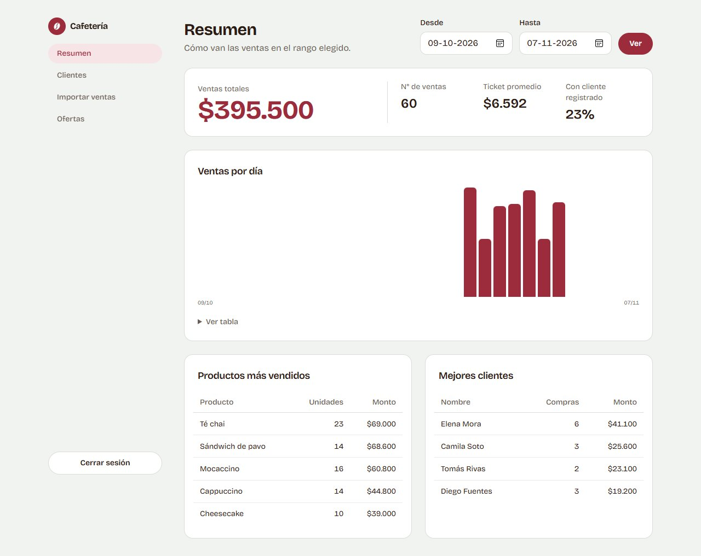
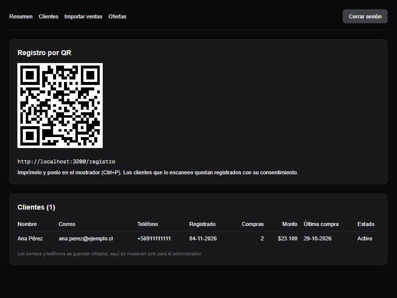
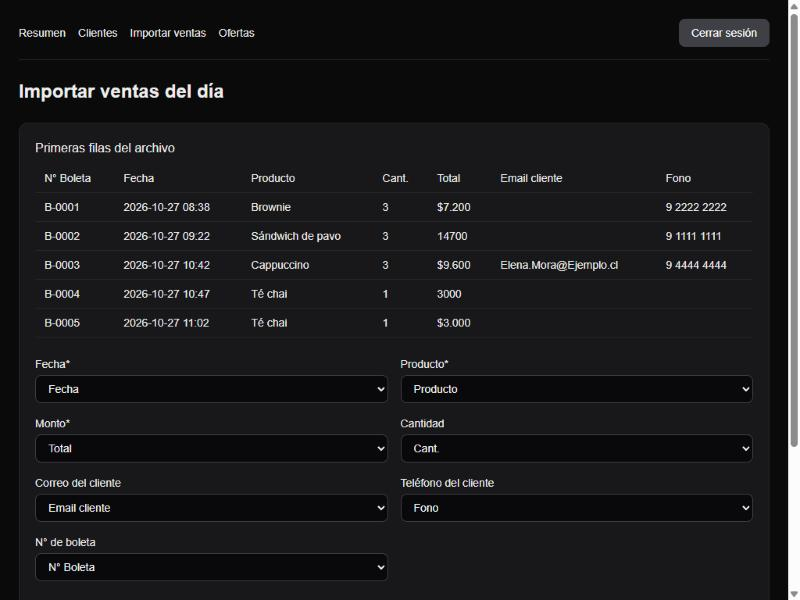
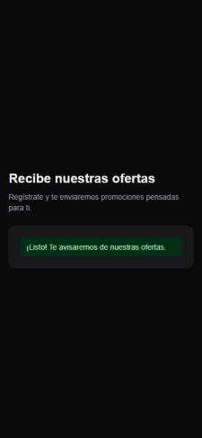
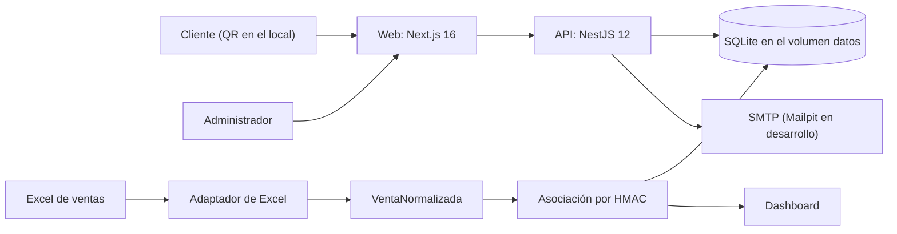

# Cafetería · Marketing con QR y ventas


Sistema de marketing para una cafetería que ya tiene su sistema de ventas: los clientes se registran desde un QR, el administrador sube el Excel de ventas del día y envía ofertas por correo a los clientes que compran cierto producto.

## Qué hace

1. **Registro por QR.** El cliente escanea el QR del local y se registra con su nombre, un correo o teléfono, y su consentimiento explícito.
2. **Importación de ventas.** El administrador sube el Excel de ventas del día (`.xlsx`, máximo 5 MB) y elige qué columna corresponde a cada campo.
3. **Asociación.** Cada venta que trae correo o teléfono se asocia al cliente registrado, aunque ese cliente se haya registrado después de la venta.
4. **Dashboard.** Muestra ventas, productos y clientes top en un rango de fechas.
5. **Ofertas.** El administrador envía una oferta por correo a un segmento, por ejemplo "clientes con 2 o más compras de latte en los últimos 30 días".

## Capturas









> Capturas del diseño anterior en [docs/capturas/v1](docs/capturas/v1).

Todos los datos de las capturas son falsos (dominio `ejemplo.cl`).

## Stack

| Capa | Tecnología |
|------|------------|
| Backend | NestJS 12 (API en `apps/api`) |
| Frontend | Next.js 16 con Tailwind CSS (en `apps/web`) |
| Base de datos | SQLite con Prisma 7 y el driver better-sqlite3 |
| Tipos compartidos | `packages/shared` |
| Tests | Vitest y Supertest |
| Infraestructura | Docker Compose (API, web y Mailpit), GitHub Actions |

## Cómo arrancarlo

Requisitos: Docker con Docker Compose, y Node.js 24 o superior para el script que crea el `.env`.

```bash
# 1. Crea el archivo .env con secretos aleatorios (no sobrescribe uno existente)
node scripts/crear-env.mjs    # o: npm run env

# 2. Levanta todo
docker compose up -d --build
```

Después de levantarlo:

- **Web:** http://localhost:3000 (el panel está en `/panel`, el inicio de sesión en `/login` y el registro de clientes en `/registro`).
- **API:** http://localhost:3001/api (salud del servicio en `/api/health`).
- **Bandeja de correos de prueba (Mailpit):** http://localhost:8025.
- **Administrador:** entra con el correo `ADMIN_EMAIL` (por defecto `admin@cafeteria.local`) y la contraseña `ADMIN_PASSWORD`. Ambos valores están en `.env`.

Notas:

- Los puertos se cambian en `.env`; el QR y los enlaces de baja siguen al puerto de la web. Con un dominio propio, agrega `APP_URL=https://tu-dominio` (y `COOKIE_SECURE=true` si usas HTTPS); ambas están comentadas en `.env.example`.
- `ADMIN_EMAIL` y `ADMIN_PASSWORD` solo se usan la primera vez, para crear al administrador; cambiarlos después en `.env` no modifica al administrador ya creado.
- Si Docker Compose se queja de una variable faltante, es porque no se ejecutó el script del paso 1.
- Las migraciones se aplican solas al arrancar la API. La base SQLite vive en el volumen `datos`.

## Demo guiada

1. Abre http://localhost:3000/login e inicia sesión como administrador.
2. En **Clientes** aparece el QR, que apunta a `/registro`. Registra un cliente desde `/registro` con un correo o teléfono que aparezca en el Excel de ejemplo, por ejemplo `ana.perez@ejemplo.cl` o el teléfono `9 1111 1111`.
3. En **Importar ventas** sube `docs/ejemplo-ventas.xlsx`. Tiene 60 ventas falsas de una semana (del 27-10 al 02-11-2026) y 2 filas con errores a propósito. La pantalla intenta adivinar las columnas, y tú confirmas el mapeo.
4. En **Resumen** elige ese rango de fechas.
5. En **Ofertas** envía una oferta y revísala en Mailpit (http://localhost:8025).

## Arquitectura



- La **web** (Next.js) es la única que habla con el navegador. Las Server Actions llaman a la API desde el servidor, así que el navegador nunca recibe el token de sesión ni la dirección interna de la API. Ojo: `docker compose` publica el puerto 3001 de la API en tu máquina para facilitar el desarrollo; en producción no debería exponerse.
- La **API** (NestJS) concentra la lógica: registro, importación, dashboard y ofertas.
- La **base** es un archivo SQLite dentro de un volumen de Docker.
- Los correos salen por SMTP. En desarrollo, Mailpit los atrapa y no salen de la máquina.

Más detalle del plan y de las reglas de negocio en `docs/PLAN_MVP.md`.

## Seguridad y privacidad

- **Datos de contacto cifrados:** el correo y el teléfono de los clientes se guardan con AES-256-GCM (IV aleatorio). Un archivo `.db` copiado no revela contactos.
- **Búsqueda sin texto plano:** los contactos se buscan con HMAC-SHA256 (con una clave aparte). Las ventas guardan solo ese HMAC, nunca el contacto.
- **Sesión del administrador:** es un JWT en una cookie httpOnly que solo usa el servidor de Next. El login responde igual, y tarda lo mismo, si el correo no existe o si la contraseña es incorrecta.
- **Registro con consentimiento:** exige consentimiento explícito. Responde lo mismo si el cliente ya existía, así que no revela quién está registrado. Registrarse de nuevo con un contacto existente solo renueva el consentimiento: no cambia el nombre ni los contactos, para que nadie pueda reemplazar los datos de otra persona conociendo su correo o teléfono.
- **Baja segura:** es un POST con confirmación y un token aleatorio. Así, los antivirus de correo que abren enlaces no dan de baja a nadie.
- **Correos:** cada correo lleva enlace de baja y el encabezado `List-Unsubscribe`. El destinatario, el asunto y el nombre se validan contra saltos de línea para evitar inyección de encabezados.
- **Logs:** no incluyen datos personales.
- **Secretos:** la API no arranca si falta un secreto o tiene un largo inválido. Las claves y el `.env` nunca se suben a git.
- **Excel:** se procesa en memoria y no se guarda.

Importante: si se pierden `CLIENTES_ENC_KEY` o `CLIENTES_HMAC_KEY`, los datos de los clientes no se pueden recuperar. Guárdalas en un lugar seguro.

## Decisiones de diseño

- **SQLite en vez de PostgreSQL:** es un solo archivo, alcanza para una cafetería, y Prisma permite migrar cambiando el `provider`.
- **Patrón Adapter para la importación:** no conocemos el formato del sistema de caja, así que cada fuente se traduce a `VentaNormalizada`. Mañana se puede sumar un CSV o una API sin tocar el resto.
- **Deduplicación con número de boleta o huella:** se usa el número de boleta o un SHA-256 de la fila, más un contador. Así, subir dos veces el mismo archivo no duplica ventas.
- **Monorepo con `packages/shared`:** si cambia un contrato, la compilación de la API o de la web falla.
- **Next.js 16 con `proxy.ts` y Server Actions:** la sesión y la comunicación con la API quedan en el servidor.

## Estructura del repo

```
apps/
  api/          NestJS: src/ (auth, clientes, importaciones, dashboard, ofertas,
                correo, seguridad, config, prisma), prisma/ (schema y migraciones),
                test/ (pruebas e2e)
  web/          Next.js: src/app (login, registro, baja, panel), src/lib, src/components
packages/
  shared/       Tipos compartidos entre la API y la web
docs/           Plan del MVP, Excel de ejemplo y capturas
scripts/        crear-env.mjs (genera el .env)
.github/workflows/  CI (lint, tests, build e imágenes Docker)
```

## Tests y CI

```bash
npm test      # API: 109 unitarias y 84 e2e; web: 9
npm run lint  # oxlint + eslint + revisión de tipos (tests incluidos)
npm run build
```

- Las pruebas e2e usan una base SQLite temporal para cada corrida y un transporte de correo falso.
- El CI (`.github/workflows/ci.yml`) corre lint, tests y build; luego construye las imágenes de Docker, levanta el stack con `docker compose up --wait` y comprueba que la API y la web respondan (eso prueba que las migraciones se aplican al arrancar).
- Hay tests de autorización para todas las rutas del administrador: sin token, token mal formado, firmado con otra clave y vencido.

## Desarrollo sin Docker

```bash
npm install
npm run env                                   # crea .env
npm run build:shared                          # compila shared y genera el cliente de Prisma
npm run prisma:migrate -w @cafeteria/api      # aplica las migraciones
npm run start:dev -w @cafeteria/api           # API en el puerto 3001
npm run dev -w @cafeteria/web                 # web en el puerto 3000
```

Para ver los correos sin Docker, levanta solo Mailpit con `docker compose up -d mailpit`.

## Límites y próximos pasos

Fuera del MVP, y cosas que faltan:

- Sin límite de peticiones (rate limiting) en el registro público ni en el login.
- Sin doble confirmación del correo (*double opt-in*): quien conoce el correo o el teléfono de alguien que se dio de baja puede volver a suscribirlo.
- Cerrar sesión borra la cookie, pero el token no se revoca: sigue siendo válido hasta que vence (8 horas).
- Las fechas de las ventas se interpretan en la hora de Chile (`America/Santiago`, fija en `apps/api/src/comun/hora.ts`).
- Solo hay adaptador de Excel (`.xlsx`). CSV y otras fuentes quedan para después.
- Un solo administrador, sin roles.
- Correos en texto plano, sin plantillas HTML.
- El envío de ofertas es secuencial y ocurre dentro de la petición, sin cola.
- Sin despliegue público todavía.
- La API no tiene documentación Swagger.
